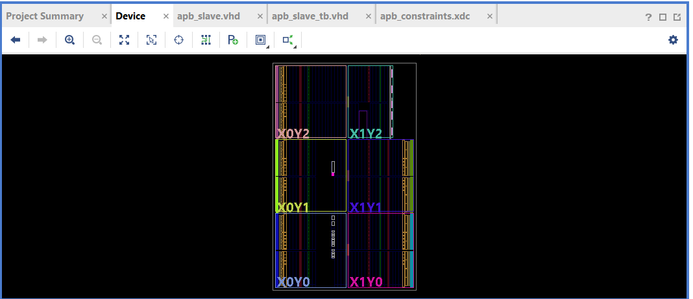
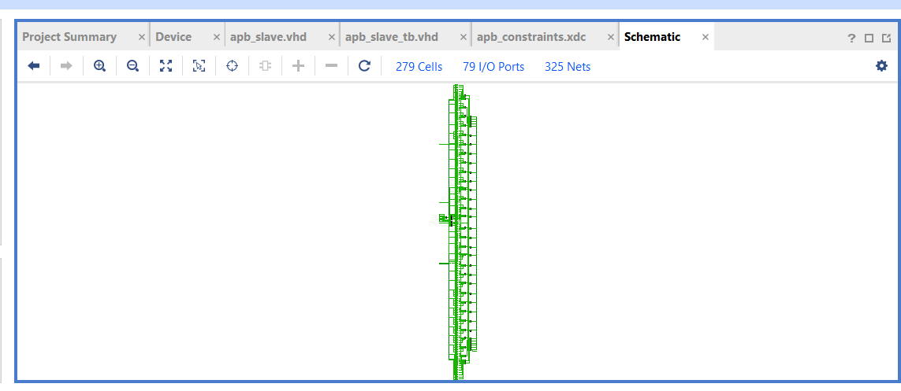

\# APB Register Block – VHDL


\## Project Overview


This project implements a simple \*\*AMBA Advanced Peripheral Bus (APB) Slave Register Block\*\* using VHDL.


The design contains four 32-bit memory-mapped registers and supports APB read and write operations. It was developed and simulated using AMD Vivado 2024.1.


\## Features


\- APB slave interface

\- Four 32-bit memory-mapped registers

\- Synchronous write operations

\- Asynchronous read-data output

\- Active-low asynchronous reset

\- Zero-wait-state operation (`PREADY = 1`)

\- Invalid-address detection using `PSLVERR`

\- VHDL testbench with functional assertions


\## Register Map


| Address | Register | Width |

|---|---|---|

| 0x00 | REG0 | 32 bits |

| 0x04 | REG1 | 32 bits |

| 0x08 | REG2 | 32 bits |

| 0x0C | REG3 | 32 bits |


Unsupported addresses generate an APB slave error during the access phase.


\## Project Structure


```text

APB-Register-Block-VHDL-GitHub/

│

├── rtl/

│   └── apb\_slave.vhd

│

├── testbench/

│   └── apb\_slave\_tb.vhd

│

├── constraints/

│   └── apb\_constraints.xdc

│

├── reports/

│   ├── apb\_utilization.rpt

│   └── apb\_timing\_summary.rpt

│

├── screenshots/

│   ├── apb\_synthesized\_schematic.png

│   └── apb\_implemented\_schematic.png

│

└── README.md

```


\## Verification


The VHDL testbench verifies:


\- Reset operation

\- Writes to all four registers

\- Reads from all four registers

\- Correct read-data values

\- Idle-state read output

\- Invalid-address detection

\- Invalid-write protection

\- Register contents after reset

\- PREADY behavior


Simulation completed successfully in Vivado XSim with no assertion errors.


\## FPGA Implementation


\*\*Development Environment:\*\* AMD Vivado 2024.1  

\*\*Target FPGA:\*\* Artix-7 (`xc7a35tcpg236-1`)  

\*\*Clock Constraint:\*\* 10 ns (100 MHz)


\### Resource Utilization


| Resource | Used |

|---|---:|

| Slice LUTs | 70 |

| Slice Registers | 128 |

| Slices | 64 |

| Block RAM | 0 |

| DSPs | 0 |


\### Timing Results


\- Setup WNS: INF

\- Setup TNS: 0 ns

\- Pulse Width WNS: 4.5 ns

\- Clock: PCLK, 100 MHz


\*\*Timing note:\*\* The clock constraint is defined in the XDC file. External input and output delay constraints have not yet been specified, so complete external I/O timing analysis remains pending.


\## Tools Used


\- VHDL

\- AMD Vivado 2024.1

\- XSim Simulator

\- Artix-7 FPGA


\## Learning Outcomes


Through this project, I gained practical experience in:


\- Understanding the APB protocol

\- Designing memory-mapped registers

\- Implementing VHDL read/write logic

\- Developing self-checking testbenches

\- Functional simulation and debugging

\- FPGA synthesis and implementation

\- Timing and resource utilization analysis


\## Author


Padma Shree Kondrahalli Byra Reddy


Master's Student – Information and Electrical Engineering  

Hochschule Wismar, Germany

## Hardware Design Schematics

### Synthesized Design


### Implemented Design

